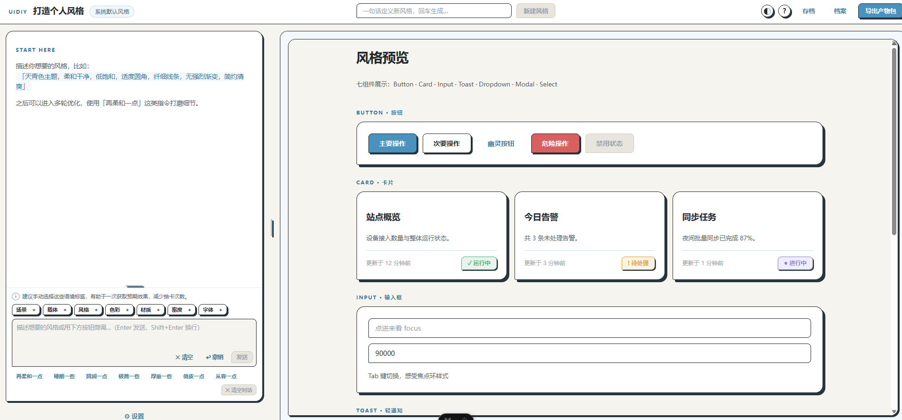
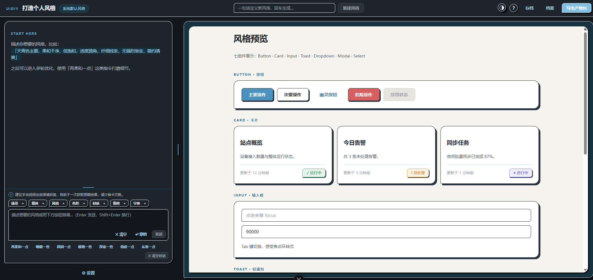
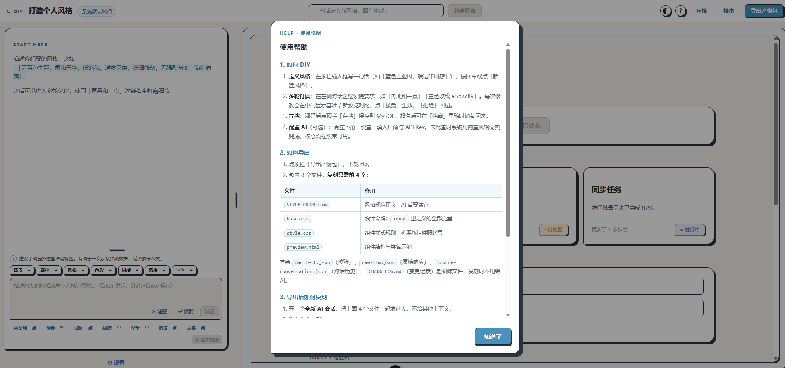
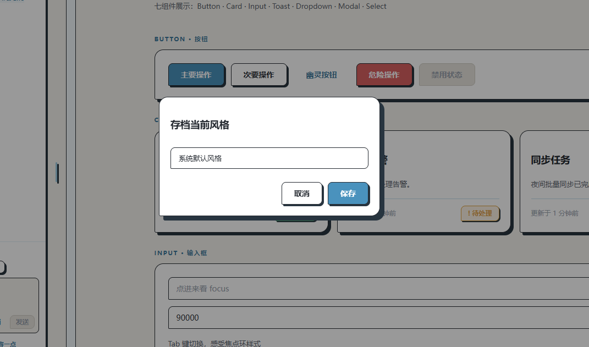
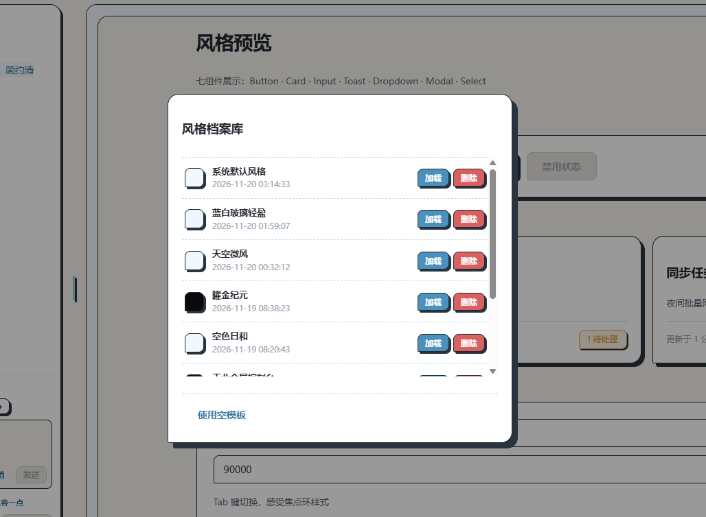
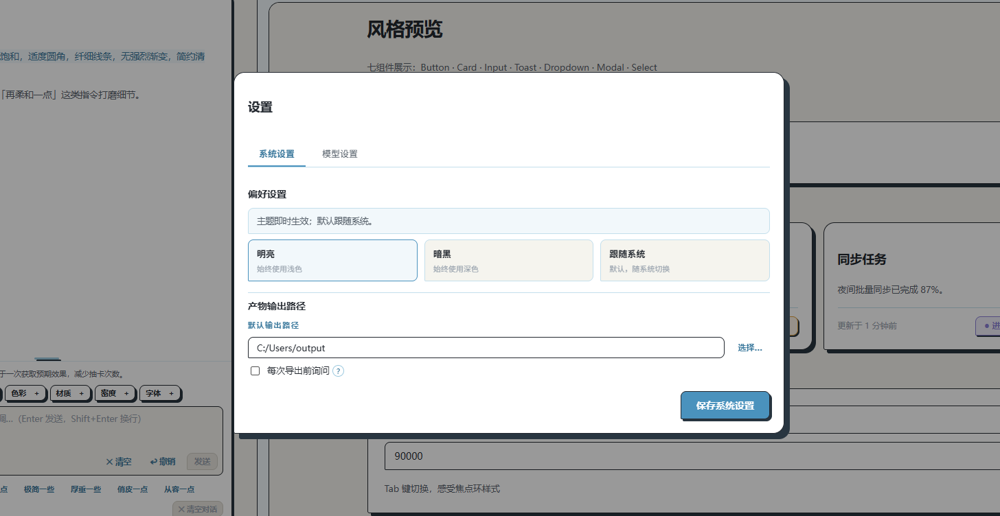
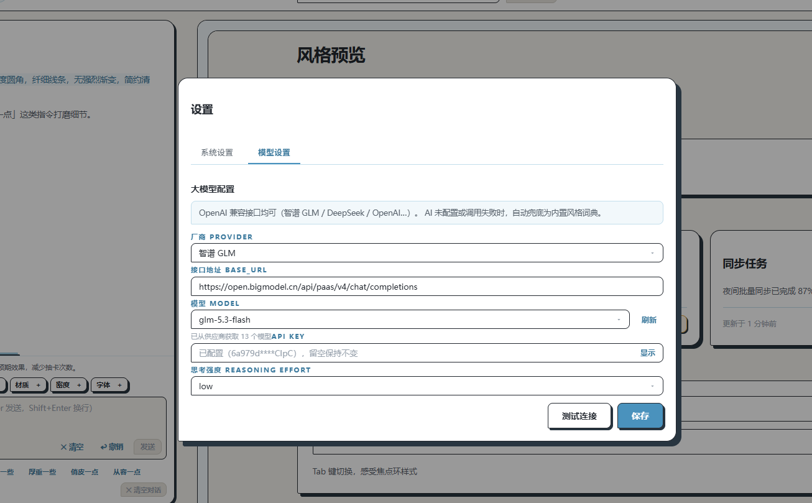
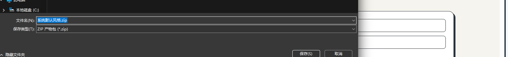

# UIDiy · 一句话定义你的 UI 风格

项目门户：<http://uidiy.wzdfk.top>　源码仓库：<https://github.com/wzdfk/WzdfkDiy>

把「UI 风格抽卡」工程化：用一句话定义风格，然后通过对话调整细节，实时预览，最后导出一套可直接交给 AI 复刻的风格产物包。

风格不再是设计师脑子里的隐性知识，而是一组可导出、可复现、可交接的令牌与提示词。

## 它能做什么

- **一句话生成**：输入「蓝白玻璃质感，柔和投影」这类描述，即刻得到完整风格
- **多轮微调**：对话里说「再柔和一点」「主色改成 #5b7c89」，改动映射到具体样式维度
- **所见即所导**：预览 iframe 注入的就是产物包里真实的 CSS，不是示意图
- **可复刻交付**：导出的 zip 交给任意新 AI 会话，按提示词和令牌即可扩展新组件
- **无需 AI 也能用**：未配置模型时走内置风格词典，核心流程照常可用

## 界面预览

| 截图 | 页面功能 |
| --- | --- |
|  | 浅色主题下的主工作台：顶栏定义新风格，左侧对话，中间实时预览 Button / Card / Input 等组件 |
|  | 切换到暗黑主题 |
|  | 「使用帮助」弹窗：定义风格、多轮微调、配置 AI、导出与复刻的操作说明 |
|  | 「存档」弹窗：为当前风格命名并保存到档案库（需配置 MySQL） |
|  | 「档案」弹窗：查看历史风格档案，加载或删除；底部可切换到内置空模板 |
|  | 设置 - 系统设置：主题偏好（明亮 / 暗黑 / 跟随系统）、默认输出路径、导出前询问开关 |
|  | 设置 - 模型设置：选择厂商与模型、填写接口地址和 API Key、设置思考强度并测试连接 |
|  | 导出产物包时选择保存位置并确认 zip 文件名（截图已裁剪，避免展示本机文件夹列表） |

## 技术栈

| 层 | 技术 |
| --- | --- |
| 前端 | Vue 3 · TypeScript · Pinia · Vue Router · Naive UI · Vite |
| 后端 | Python 3.12+ · FastAPI · Pydantic v2 · Jinja2 · SQLAlchemy · PyMySQL · httpx |
| 预览 | iframe `srcdoc` + 后端实时生成的 CSS，令牌驱动、伪调用归零 |
| 存储 | MySQL 8（仅「存档 / 档案」使用，可选） |
| AI | 任意 OpenAI 兼容接口（智谱、DeepSeek、OpenAI 等，可选） |

## 快速开始

前置：Python 3.12+、Node.js 18+、MySQL 8（可选）、AI Key（可选）

### 1. 启动后端

```bash
cd backend
python -m venv .venv
# Windows PowerShell
.\.venv\Scripts\Activate.ps1
# macOS / Linux
source .venv/bin/activate

pip install -r requirements.txt
cp .env.example .env          # Windows 用 copy .env.example .env
python main.py                # 监听 127.0.0.1:8300
```

接口文档：<http://127.0.0.1:8300/docs>　健康检查：<http://127.0.0.1:8300/api/health>

### 2. 启动前端

```bash
cd frontend
npm install
npm run dev                    # 监听 http://localhost:5180
```

前端用 Vite 代理把 `/api` 转到后端，浏览器侧是同源请求，无需配置 CORS。

### 3. 验证跑通

打开 <http://localhost:5180>，顶栏输入「蓝白玻璃质感，柔和投影」并回车。左侧出现对话、中间出现实时预览即成功。

## 配置说明

| 变量 | 必填 | 说明 |
| --- | --- | --- |
| `BASE_URL` / `API_KEY` | 否 | OpenAI 兼容接口；留空走内置风格词典 |
| `DB_HOST` / `DB_PORT` / `DB_USER` / `DB_PASSWORD` / `DB_DATABASE` | 否 | 留空则「存档 / 档案」不可用，其余功能正常 |

AI 配置也可以进界面左下角「设置」填写，保存到 `backend/app/data/llm_settings.json`，优先级高于环境变量。

## 导出的产物

点顶栏「导出产物包」导出 zip：默认写入系统设置中的输出目录（初始为 `C:/Users/output`）；若勾选「每次导出前询问」，则每次导出时选择保存位置。包内 8 个文件，交给 AI 复刻**只需前 4 个**：

| 文件 | 作用 |
| --- | --- |
| `STYLE_PROMPT.md` | 风格规范正文，AI 首要读它 |
| `base.css` | `:root` 里定义的全部设计令牌 |
| `style.css` | 组件样式规则 |
| `preview.html` | 组件结构与类名示例 |

其余 `manifest.json`（校验）、`raw-llm.json`（原始响应）、`source-conversation.json`（对话历史）、`CHANGELOG.md`（变更记录）是溯源文件，复刻时不用给 AI。

复刻时把前 4 个文件一起发给一个新 AI 会话，要求按 `STYLE_PROMPT.md` 的风格签名和 `base.css` 的变量扩展新组件即可。**每套产物的变量前缀和风格签名都不同，以文件本身为准，不要套用别的风格标准。**

## 目录结构

```text
backend/
  app/api/          FastAPI 路由：风格生成/对话/导出/存档/设置
  app/core/         令牌、CSS 生成、提示词、导出打包
  app/templates/    Jinja2 CSS / 文档模板
  app/data/         运行时数据（llm_settings.json）
frontend/
  src/views/        工作台
  src/components/   对话、预览、FdSelect 等
  src/assets/       FOLD 设计系统与帮助文档
  src/preview/      预览文档处理
docs/               产品需求、技术方案、组件清单、复刻自检报告
images/             README 界面截图
portal/             静态项目门户（uidiy.wzdfk.top）
scripts/            快速验证脚本
outputs/            本地导出的示例产物（不入库）
fold-showcase.html  默认折角风格展示页
fold-design-system.css  默认折角设计系统
```

## 许可证

MIT License，详见 `LICENSE`。
